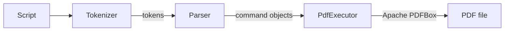

# PDF Description Language

Write a short script, click **Create PDF**, get a finished document with text, tables, images and
fillable form fields.

The project has its own small language, a hand-written tokenizer and parser, and an executor that
renders the result with [Apache PDFBox](https://pdfbox.apache.org/). A Swing editor ties it together.


*The page above comes from [`examples/showcase.txt`](examples/showcase.txt). The name, e-mail and
company boxes are real form fields that can be filled in with any PDF viewer.*

---

## Contents

- [Getting started](#getting-started)
- [Your first PDF](#your-first-pdf)
- [Language basics](#language-basics)
- [Command reference](#command-reference)
- [Full example](#full-example)
- [How it works](#how-it-works)
- [Limitations](#limitations)
- [Authors](#authors)

## Getting started

**Requirements:** JDK 24 (as set in `pom.xml`) and Maven. PDFBox 3.0.2 is the only dependency and
Maven downloads it automatically.

```bash
git clone https://github.com/michaelbabsek/AbschlussProjektSWP1.git
cd AbschlussProjektSWP1
mvn compile exec:java -Dexec.mainClass=Main
```

Alternatively, open the folder in IntelliJ IDEA and run `Main`.

## Your first PDF

The editor opens with a code area on top and a **Create PDF** button below it. Type a script and click
the button:

```text
output "hello.pdf"
font size 18 style bold "helvetica"
print "Hello, PDF!\n"
font size 12 style regular "helvetica"
print "This line was written by a script."
```

The PDF is saved to the path given in `output`, relative to the folder the program was started from.
An existing file with the same name is overwritten. If the script contains an error, the message is
printed to the console.

## Language basics

A script is a sequence of commands. Each command starts with its keyword, followed by its parameters
in any order.

| Element | Syntax | Example |
|---|---|---|
| Text | double quotes | `"Hello"` |
| Line break inside text | `\n` | `"line 1\nline 2"` |
| Quote and backslash | `\"` and `\\` | `"say \"hi\""` |
| Choice from a fixed list | curly braces | `{center}`, `{textbox}`, `{bullet}` |
| Number | integer or decimal, may be negative | `12`, `1.5`, `-4` |
| Colour | name, `#RRGGBB` or `0xRRGGBB` | `red`, `#1F4E8C`, `0xA0A0A0` |
| Position | `@ x,y` | `@ 32,700` |
| Table cell | `@ cell column,row` | `@ cell 1,0` |

- Keywords and values are case-insensitive: `PRINT` works like `print`.
- Line breaks and spaces between commands don't matter, so several commands may share one line.
- A dot at the end of a command is optional: `print "Hi".`
- Colour names are the ones Java knows: `black`, `blue`, `cyan`, `dark_gray`, `gray`, `green`,
  `light_gray`, `magenta`, `orange`, `pink`, `red`, `white`, `yellow`.

### Coordinates and the cursor

Positions are given in **PDF points** (1/72 inch). The origin `0,0` is the **bottom-left** corner of
the page. Pages are A4 (595 × 842 pt) with a margin of 32 pt.

Like a typewriter, the program keeps a **cursor**. It starts at the top-left of the text area, and
every `print` continues exactly where the previous one stopped. Use `\n` to start a new line, or set a
position with `@ x,y`. Long text wraps automatically at the right margin and continues on a new page
when it reaches the bottom margin.

## Command reference

| Command | Purpose |
|---|---|
| [`output`](#output) | Set the file name of the PDF (required, once) |
| [`font`](#font) | Change font, size, style and colour for everything that follows |
| [`print`](#print) | Write text |
| [`symbol`](#symbol) | Write a bullet or dash |
| [`table`](#table) | Draw a table grid |
| [`control`](#control) | Add a fillable form field |
| [`image`](#image) | Insert a PNG or JPEG image |
| [`nextpage`](#nextpage) | Start a new page |

### output

```text
output "report.pdf"
```

Must appear exactly once. The file is written when the whole script has run.

### font

```text
font size 14 style bold colour #1F4E8C "helvetica"
```

| Parameter | Values | Default |
|---|---|---|
| font name | `"helvetica"`, `"times"`, `"courier"`, `"symbol"`, `"zapf_dingbats"` | `helvetica` |
| `size` | number in points | `12` |
| `style` | `regular`, `bold`, `italic`, `bold_italic`, `oblique`, `bold_oblique` | `regular` |
| `colour` / `color` | colour name or hex value | `black` |

All parameters are optional. The style only changes together with a font name, so write
`font style bold "helvetica"` rather than `font style bold`.

### print

```text
print "Plain text at the cursor\n"
print @ 300,500 "Text at a fixed position"
print {center} "A centred heading\n"
print @ cell 0,1 "Text inside a table cell"
```

- Alignment: `{left}` (default), `{center}` or `{right}`, measured across the text area of the page.
- `@ cell column,row` places the text inside a cell of the most recent table.

### symbol

```text
symbol {bullet} print " First item\n"
symbol {dash} print " Second item\n"
```

Writes `•` or `–` at the cursor, so the following `print` continues on the same line. A symbol also
accepts `@ x,y`, `@ cell column,row` and `alignment {center}`.

### table

```text
table columns 3 rows 4 width 120,200,80 height 24* line #1F4E8C background light_gray thickness 1
```

| Parameter | Meaning | Default |
|---|---|---|
| `columns`, `rows` | number of columns and rows | required |
| `width` | column widths in points, separated by commas | 50 each |
| `height` | row heights in points, separated by commas | 50 each |
| `line` | colour of the grid lines | current font colour |
| `background` | fill colour of the cells | none |
| `thickness` | line width in points | 1 |

A `*` after the last value repeats it for all remaining columns or rows: `height 30,20*` gives a
30 pt header row and 20 pt for every row after it.

The table is drawn with its top-left corner at the cursor. Cells are numbered from `0,0` (top-left) as
`column,row`. Fill them with `print @ cell …`, `control @ cell …` or `symbol @ cell …`.

### control

Adds an interactive form field that can be filled in with any PDF viewer.

```text
control @ cell 1,0 {textbox} "Jane Doe"
control @ cell 1,1 {dropdown} "Machine Learning;Web Development;Embedded Systems"
control @ cell 1,2 {radio} "Beginner;Intermediate;Advanced"
control @ cell 1,3 {option} "Yes, keep me informed"
```

| Type | Content |
|---|---|
| `{textbox}` | pre-filled text (may be `""`) |
| `{dropdown}` | choices separated by `;`, the first one is selected |
| `{radio}` | choices separated by `;`, shown one below the other |
| `{option}` | a checkbox with this label |

The type and content can also be written out as `type textbox content "Jane Doe"`. Place a field with
`@ x,y` or `@ cell column,row`. Inside a cell, the field takes the size of the cell, so give
radio groups enough row height for all choices. Form fields do not move the cursor.

### image

```text
image "logo.png" @ 32,800 size 40,40
```

- The path is relative to the folder the program was started from.
- Without `size`, the image keeps its pixel size. Images larger than the page are scaled down to fit.
- Without `@ x,y`, the image is placed at the cursor and starts a new page if it doesn't fit.

### nextpage

```text
nextpage
```

Starts a new page and moves the cursor to its top-left corner.

## Full example

[`examples/showcase.txt`](examples/showcase.txt) produces the page at the top of this README:

```text
output "showcase.pdf"

image "logo.png" @ 32,800 size 40,40
font size 20 style bold "helvetica"
print @ 82,790 "Workshop Registration"
font size 11 style regular colour gray "helvetica"
print @ 82,774 "Please fill in the form and send it back by 15 March."

font size 12 colour black "helvetica"
print @ 32,730 "What you get:\n"
symbol {bullet} print " Two days of hands-on sessions\n"
symbol {bullet} print " Lunch and coffee included\n"
symbol {bullet} print " Certificate of attendance\n\n"

table columns 2 rows 3 width 140,300 height 28* line #1F4E8C thickness 1
print @ cell 0,0 "Name"
control @ cell 1,0 {textbox} "Jane Doe"
print @ cell 0,1 "E-mail"
control @ cell 1,1 {textbox} "jane.doe@example.com"
print @ cell 0,2 "Company"
control @ cell 1,2 {textbox} ""

font size 9 colour dark_gray "courier"
print @ 32,520 "Generated from a 20-line script."
```

To run it, start the program from the `examples` folder (so that `logo.png` is found) and paste the
script into the editor.

## How it works



| Package | Responsibility |
|---|---|
| `tokens` | `Tokenizer` turns the script into words, strings, numbers, `{choices}`, colours and symbols, and keeps line and column for error messages |
| `commands` | `Parser` builds one immutable command object per command (`PrintCommand`, `TableCommand`, …) |
| `executor` | `PdfExecutor` runs the commands: cursor and font state (`RenderState`), word wrapping and page breaks, fonts (`FontHandler`), colours (`ColorHandler`) and form fields (`ComponentFactory`) |
| `table` | Cell geometry for tables |
| `ui` | The Swing editor (`EditorWindow`) |

## Limitations

- Only the 14 standard PDF fonts are available. Characters they cannot display are replaced with
  `[?]` and listed on the console; this includes tab characters.
- Scripts can't contain comments yet.
- Only one table is active at a time: `@ cell` always refers to the most recent table.

## Authors

Michael Babsek and Annea Schelling, university project at HFT Stuttgart (course SWP1).
